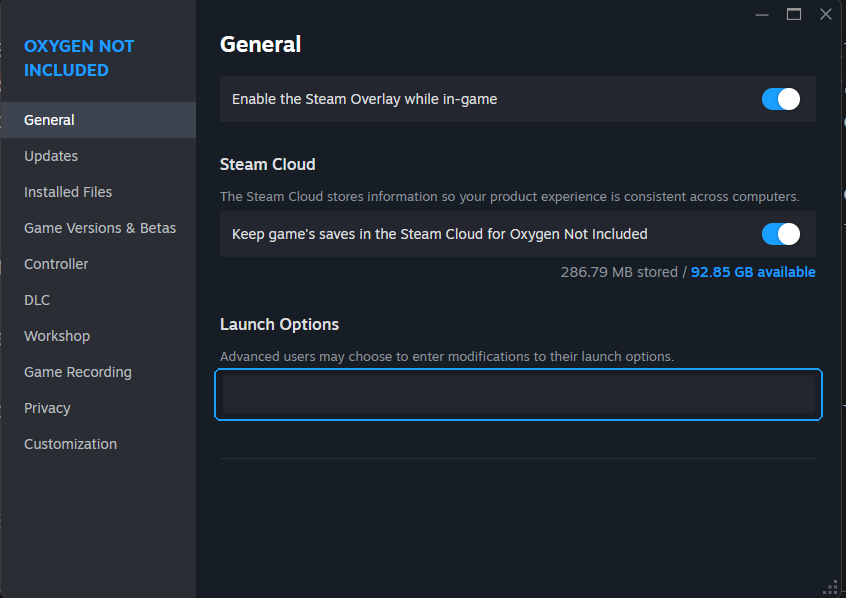
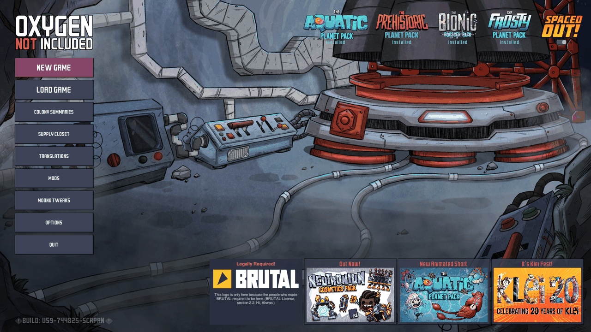

# Moono

An unofficial, super fast, super sussy replacement for the Unity layer of Oxygen Not Included,
artisanally crafted by Claude. On a late-game colony the game runs at about 8× the original's
frame rate ([Performance](#performance)).

I did this mostly for fun, to see how far Oxygen Not Included's performance can go on a modern
.NET runtime (CoreCLR). I've had the idea for a while, but none of the existing C# renderers
sparked joy. When [BRUTAL](https://github.com/ahwootech/BRUTAL) went open source, it seemed like
a good excuse to try a sexy new toy.

Klei's game DLLs load as they are, apart from three small compatibility fixes. Whatever they call
into Unity for is reimplemented here.

## Setup

You need your own copy of the game on Steam, on Linux or Windows (no macOS). Epic Games Store
and WeGame (China) are not currently supported. Because this replaces
the engine rather than patching the game, it can't ship as an ordinary Harmony mod. Instead, a
setup script hooks it into the game's Steam launch options, so you still start the game from
Steam as usual.

1. Download the latest release from the
   [releases page](https://github.com/tigin-backwards/oni-moono/releases/latest):
   `oni-moono-…-windows-x64.zip` or `oni-moono-…-linux-x64.tar.gz`, and extract it anywhere.
   (Or clone this repository; the setup then builds the player itself, installing the .NET SDK
   for your user if you don't have it.)
2. Run the setup script in the extracted `oni-moono` folder:
   - Windows: double-click `setup.cmd` (it runs `setup.ps1` and keeps the window open)
   - Linux: `./setup.sh`

   It finds your Oxygen Not Included install through Steam, and prints one line for the game's
   launch options, and puts it on your clipboard where it can.
3. In Steam, right-click Oxygen Not Included → Properties → Launch Options, and paste that line.

   

Then press Play in Steam as usual. The optional tweaks (below) are chosen in the game: **Moono
Tweaks** on the main menu, under Mods. To update, get the new version and run the setup again; the
launch options stay the same, and so do your tweak choices. To go back to the original game, clear
the launch options.

Coming from a release from before the Moono name (oni-brutal)? Its launch options start the old
player (`OniBrutal`), so run the new setup once and paste the new line it prints (the player is
now `OniMoono`, installed in an `oni-moono` folder). Your tweak choices carry over; the old
`oni-brutal` folder can be deleted afterwards.

On Linux, Steam installed as a Flatpak or a snap runs games in a sandbox that can't see most of
your home folder; the setup notices and installs the player inside the sandbox's own folder.
(Snap is tested; Flatpak isn't yet.)

You'll need an OpenGL 4.5 graphics driver. The game uses your normal Steam account, DLCs, saves,
settings and mods.

## Performance

The biggest change is swapping the very garbage Mono runtime that Unity ships for CoreCLR. On
top of that there are optimizations tuned to the way Oxygen Not Included uses the engine.

On a late-game save (U57: Spaced Out with every DLC, cycle 17,000+), on Windows, on the same machine, back to back:

| | Original | Moono | |
|---|---|---|---|
| Frame rate at speed&nbsp;3 (default tweaks) | about 11&nbsp;fps | about 88&nbsp;fps | about 8× |
| Loading the save | 2&nbsp;min&nbsp;22&nbsp;s | about 35&nbsp;s | about 4× faster |
| Autosave freeze | about 26&nbsp;s | about 2.3&nbsp;s | about 11× shorter |
| Starting the game, to the main menu (every DLC) | about 17&nbsp;s | about 11&nbsp;s | about 1.5× faster |

Without the save tweaks the autosave freeze is about 8 s. They bring it down to about 2.3 s by
writing the save faster and moving the compression and file write to a background thread.

Garbage-collection hitches are mostly gone: collections now run in the background, spread
across every core, and their pauses are about a quarter as long.

**Note:** This uses more memory compared to the original. On a mid-game colony, memory peaked at
around 11GB resident compared to 7GB in the original. This is expected behavior for faster,
parallel collection.

https://github.com/user-attachments/assets/9d54b5ac-8583-442c-b6ad-8ddaa31e6d6d

U57 at speed 3: about 11 fps in the original, about 88 in Moono.

All the videos here are the same save, view and machine on Windows, the original on the left,
recorded back to back; each side's frame rate was measured while it was recorded.

Starting the game to the main menu, every DLC: 17.3 s in the original, 11.4 s in Moono.

https://github.com/user-attachments/assets/05494e54-e629-44bc-9ddc-bf60c054297d

An autosave on U57: the original freezes for about 26 s, Moono for about 4 s.

https://github.com/user-attachments/assets/a0534ae4-115f-4b17-b9bb-2f8c28868b89

The temperature overlay on U57, panning: about 8 fps in the original, about 50 in Moono.

https://github.com/user-attachments/assets/e0054f3c-0462-4333-955b-9ab5c8888810

2minnow, a mid-game colony, at speed 3: about 35 fps in the original, about 110 in Moono.

https://github.com/user-attachments/assets/3106d24d-67d3-4bf3-ba23-8f8dc78910f8

For a more detailed breakdown, see [docs/PERFORMANCE.md](docs/PERFORMANCE.md).

### Tweaks

Moono also speeds up some of the game's own code. Most tweaks don't change gameplay and are on by
default; three do, and are off. Toggle them in **Moono Tweaks** on the main menu. Full list:
[docs/TWEAKS.md](docs/TWEAKS.md).

## Save compatibility

Saves from the original game should load, and saves made here should still load in the
original game (including ones written with the `fast-save-compression` tweak).

Saves come out about 14% larger: the `fast-save-compression` tweak compresses them faster but a
little less tightly, which takes seconds off every save.

## Mod compatibility

Most mods should work, since the game's code and its Harmony load as shipped. See
[docs/MOD_COMPATIBILITY.md](docs/MOD_COMPATIBILITY.md) for what has been tested. If a mod breaks,
[file an issue](#issues) with your log.

## Could Klei do this?

Possibly. In the age of agents the initial prototype took about 5 days, so it isn't the
insurmountable task it might once have looked like.

However, most of the wins come from CoreCLR itself, which Unity 7's CoreCLR move should bring to
the original game too, eventually (it's been in Soon™ territory for years).

This also rebuilds only what the game needs to run. Everything that Klei's development workflow
needs from Unity would be lost:
- the editor
- Unity's shader tooling
- the asset bundle build pipeline
- profiling and debugging tools
- no macOS support yet
- the general, accumulated knowledge of how Unity behaves

So I'd only seriously look at something like this if Unity 7's CoreCLR runtime can't get
close to the same numbers.

The optional tweaks are a different story. They are potential optimizations that probably also
apply to the original game. I haven't measured them there, though, and their gains could differ
on Mono. The engine-side wins are probably not possible to port to the original game, as it
would require building Unity from source.

## Contributing

Feel free to slop. See [docs/DEVELOPMENT.md](docs/DEVELOPMENT.md).

## Issues

File an issue, and please attach your log and the save you were playing.

The log is `Player.log` in:
- Windows: `%USERPROFILE%\AppData\LocalLow\Klei\Oxygen Not Included\`
- Linux: `~/.config/unity3d/Klei/Oxygen Not Included/`

Saves are `.sav` files in a folder named after the colony, under:
- Windows: `Documents\Klei\OxygenNotIncluded\cloud_save_files\<your Steam ID>\` (or
  `save_files\` for saves kept off Steam Cloud)
- Linux: `~/.config/unity3d/Klei/Oxygen Not Included/cloud_save_files/<your Steam ID>/` (or
  `save_files/`)

With Steam installed as a snap on Linux, both folders are under `~/snap/steam/common/` instead
of `~`. With Flatpak Steam, `~/.config/` becomes `~/.var/app/com.valvesoftware.Steam/config/`.

## License

All rights reserved.

Built on [BRUTAL](https://github.com/ahwootech/BRUTAL), Copyright (c) 2024 Ahwoo Limited.
Oxygen Not Included is © Klei Entertainment. Moono is unofficial, and not affiliated with or
endorsed by Klei Entertainment, Unity Technologies, or the Mono project.

Moono is written without Unity's source code: no Unity C# reference source, decompiled Unity
assemblies or disassembled engine binaries are used. Unity's UI packages (uGUI, TextMeshPro,
Timeline) are reimplemented clean-room: their behaviour is measured from the outside, written up
as specs in [docs/cleanroom](docs/cleanroom), and implemented from those specs. Code from
open-source projects (Mono, Mesa, SGI's GLU) is used under their licences; see
[NOTICE.txt](NOTICE.txt) and [docs/LICENSING.md](docs/LICENSING.md).

## Unsigned releases

The releases are not signed, so to Windows every new one is an unknown program from the
internet. Extracting it or running setup may hold things up for a cloud antivirus scan, or show
"Windows protected your PC" (click More info → Run anyway). That's okay and expected for sussy
software like this. To skip most of it, right-click the downloaded zip → Properties → tick
Unblock before extracting.
