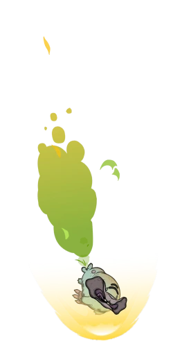
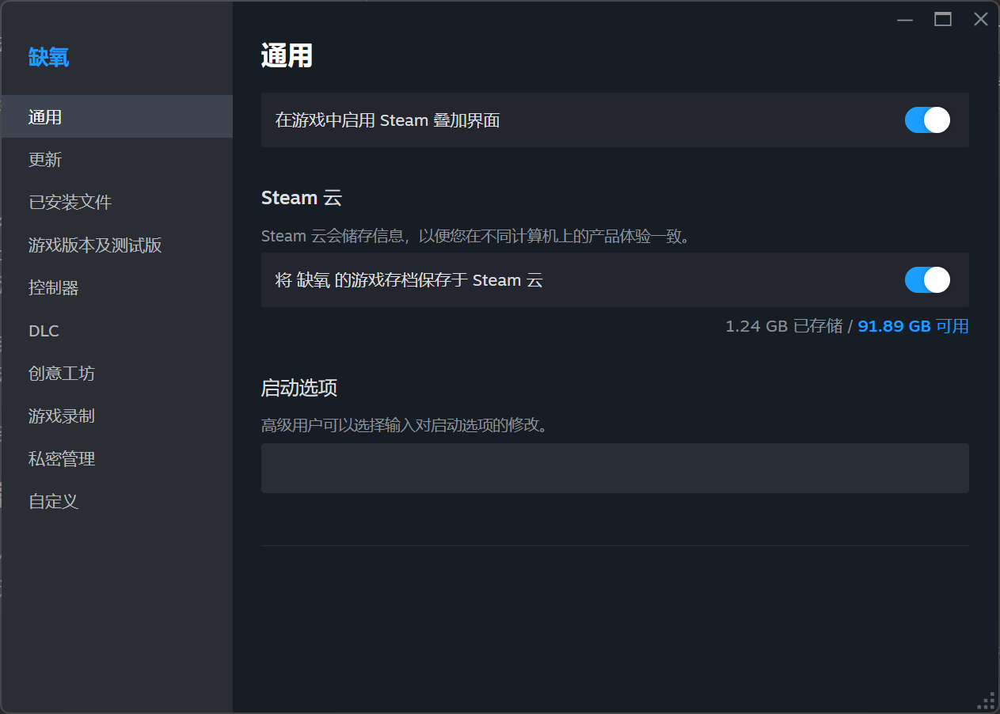
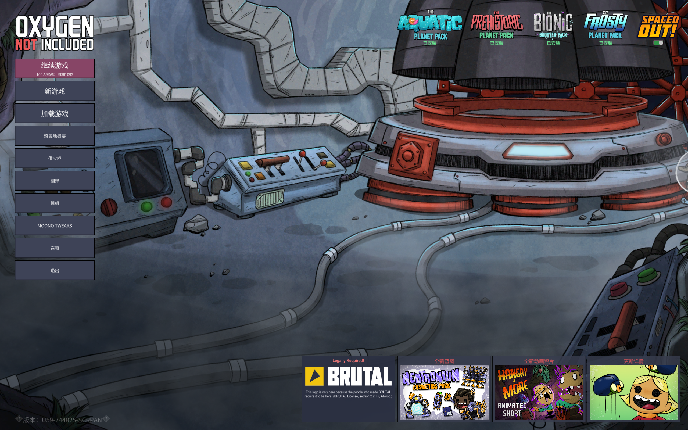
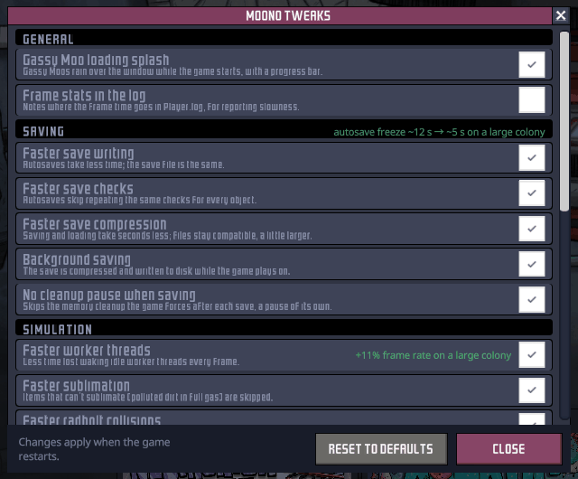

# Moono

[English](README.md) | 简体中文

一个非官方、超快、超可疑的《缺氧》（Oxygen Not Included）Unity 层替代品，由 Claude 匠心打造。在游戏后期的殖民地中，它的帧率约为原版的 8 倍（见[性能表现](#性能表现)）。

我做这件事主要是为了好玩，想看看《缺氧》在现代 .NET 运行时（CoreCLR）上的性能究竟能走多远。这个念头已经在我脑海里盘旋了一段时间，但现有的 C# 渲染器没有一个能让我心动。当 [BRUTAL](https://github.com/ahwootech/BRUTAL) 开源时，这似乎正好给了我一个尝试这个“性感新玩具”的好借口。

Moono 运行 Klei 原版的 DLL，并在加载时按照 Mono 与 .NET 的[差异](docs/ARCHITECTURE.md)打补丁。这些 DLL 需要从 Unity 获得的一切，都在这里重新实现了。

## 安装

你需要拥有 Steam 上的正版游戏，支持 Linux 或 Windows（不支持 macOS）。目前不支持 Epic Games Store 和 WeGame（中国）版本。由于本方案替换的是游戏引擎而非给游戏打补丁，因此无法作为普通 Harmony 模组发布。取而代之的是，安装脚本会把它挂接到游戏的 Steam 启动选项中，因此你仍然像往常一样从 Steam 启动游戏。

1. 从[发布页面](https://github.com/tigin-backwards/oni-moono/releases/latest)下载最新版本：
   `oni-moono-…-windows-x64.zip` 或 `oni-moono-…-linux-x64.tar.gz`，并解压到任意位置。
   （也可以直接克隆本仓库；此时安装脚本会自行构建 Moono 本体，如果你没有安装 .NET SDK，它还会为当前用户安装。）
2. 在解压后的 `oni-moono` 文件夹中运行安装脚本：
   - Windows：双击 `setup.cmd`（它会运行 `setup.ps1`，并让窗口保持打开）
   - Linux：`./setup.sh`

   脚本会通过 Steam 找到你的《缺氧》安装目录，打印出用于游戏启动选项的一行命令，并在可行时将其复制到剪贴板。
3. 在 Steam 中右键点击《缺氧》→“属性”→“启动选项”，然后粘贴这一行。

然后像往常一样在 Steam 中点击“开始游戏”。可选的调整项（见下文）在游戏内选择：主菜单“Mods”（模组）下的 **Moono Tweaks**。如需更新，获取新版本并再次运行安装脚本即可；启动选项保持不变，你的调整项选择也会保留。若要回到原版游戏，清除启动选项即可。

在 Linux 上，以 Flatpak 或 Snap 方式安装的 Steam 会在沙盒中运行游戏，而该沙盒看不到你家目录的大部分内容；安装脚本会识别这种情况，并把 Moono 本体安装到沙盒自己的文件夹中。（Snap 已测试，Flatpak 尚未测试。）

你需要 OpenGL 4.5 显卡驱动。游戏会使用你平常的 Steam 账户、DLC、存档、设置和模组。

## 性能表现

最大的变化，是把 Unity 自带的那个垃圾 Mono 运行时换成了 CoreCLR。在此基础上，还针对《缺氧》使用引擎的方式加入了一些优化。

在同一台 Windows 机器上，对同一个游戏后期存档（U57：眼冒金星，全部 DLC，第 17,000+ 周期）连续进行对比测试，结果如下：

| | 原版 | Moono | |
|---|---|---|---|
| 3 倍速下的帧率（默认调整项） | 约 11 fps | 约 88 fps | 约 8 倍 |
| 加载存档 | 2 分 22 秒 | 约 35 秒 | 快约 4 倍 |
| 自动存档卡顿 | 约 26 秒 | 约 2.3 秒 | 缩短约 11 倍 |
| 启动游戏到主菜单（全部 DLC，第二次启动） | 约 17.4 秒 | 约 9.8 秒 | 快约 1.8 倍 |

运行速度的提升幅度取决于你的硬件。Moono 消除了运行时的开销，因此 CPU 越快，你能看到的提升就越大。在较慢的机器上，你会更早遇到其他瓶颈：内存耗尽，或游戏本身的 C++ 模拟——Moono 不会加速这部分（在非常大的自定义地图上尤其明显）。

垃圾回收造成的卡顿基本消失了：回收现在在后台运行，分摊到所有核心上，停顿时间约为原来的四分之一。

**注意：** 与原版相比，这会占用更多内存。在游戏中期的一个殖民地中，常驻内存峰值约为 11GB，而原版约为 7GB。对于更快、并行的垃圾回收来说，这是预期行为。

在 U57 中以 3 倍速运行：原版约 11 fps，Moono 约 88 fps。

https://github.com/user-attachments/assets/9d54b5ac-8583-442c-b6ad-8ddaa31e6d6d

从启动游戏到主菜单（全部 DLC，第二次启动）：原版 17.6 秒，Moono 10.0 秒。

https://github.com/user-attachments/assets/cb1bf869-b031-4090-86b8-1714535f36e4

U57 上的自动存档：原版会卡住约 26 秒，Moono 约 4 秒。

https://github.com/user-attachments/assets/a0534ae4-115f-4b17-b9bb-2f8c28868b89

U57 上平移视角时的温度视图：原版约 8 fps，Moono 约 50 fps。

https://github.com/user-attachments/assets/e0054f3c-0462-4333-955b-9ab5c8888810

2minnow，一个游戏中期的殖民地，3 倍速：原版约 35 fps，Moono 约 110 fps。

https://github.com/user-attachments/assets/3106d24d-67d3-4bf3-ba23-8f8dc78910f8

如需更详细的分析，请参阅 [docs/PERFORMANCE.md](docs/PERFORMANCE.md)。

### 调整项

Moono 也会加速游戏自身的一些代码。大多数调整项不会改变玩法，且默认开启；有三项会改变玩法，默认关闭。可在主菜单的 **Moono Tweaks** 中切换。完整列表见 [docs/TWEAKS.md](docs/TWEAKS.md)。

## 存档兼容性

原版游戏的存档应当可以正常加载，在这里创建的存档也仍应能在原版游戏中加载（包括使用 `fast-save-compression` 调整项写出的存档）。

存档体积会增大约 14%：`fast-save-compression` 调整项压缩得更快，但压缩得略松，这能为每次存档省下几秒钟。

## 模组兼容性

大多数模组应该都能正常工作，因为游戏的代码及其 Harmony 都按原样加载。已测试的情况见 [docs/MOD_COMPATIBILITY.md](docs/MOD_COMPATIBILITY.md)。如果某个模组出问题，请[提交 issue](#问题反馈)并附上日志。

## Klei 能做到吗？

也许可以。在智能体（agent）时代，最初的原型只花了约 5 天，所以它并不像曾经看起来那样是一项无法逾越的任务。

不过，大部分收益来自 CoreCLR 本身，而 Unity 7 转向 CoreCLR 最终应该也会把这份收益带给原版游戏（它已经在 Soon™ 状态里待了好多年）。

此外，这个项目只重建了游戏运行所需的部分。Klei 的开发流程需要从 Unity 获得的一切都会失去：
- 编辑器
- Unity 的着色器工具
- 资源包（Asset Bundle）构建流水线
- 性能分析与调试工具
- 目前不支持 macOS
- 关于 Unity 行为方式的、长期积累的通用知识

所以，只有当 Unity 7 的 CoreCLR 运行时无法接近同样的数字时，我才会认真考虑这样的方案。

可选的调整项则是另一回事。它们是潜在的优化，很可能也适用于原版游戏。不过我没有在原版上测过，而且它们在 Mono 上的收益可能不同。引擎层面的收益大概无法移植到原版游戏，因为那需要从源码构建 Unity。

## 参与贡献

欢迎随便贡献（哪怕是“糊”出来的也行）。请参阅 [docs/DEVELOPMENT.md](docs/DEVELOPMENT.md)。

## 问题反馈

请提交一个 issue，并附上你的日志和当时正在玩的存档。

日志是以下位置中的 `Player.log`：
- Windows：`%USERPROFILE%\AppData\LocalLow\Klei\Oxygen Not Included\`
- Linux：`~/.config/unity3d/Klei/Oxygen Not Included/`

存档是 `.sav` 文件，位于以殖民地命名的文件夹中，路径如下：
- Windows：`Documents\Klei\OxygenNotIncluded\cloud_save_files\<你的 Steam ID>\`（未保存在 Steam 云端的存档则位于 `save_files\`）
- Linux：`~/.config/unity3d/Klei/Oxygen Not Included/cloud_save_files/<你的 Steam ID>/`（或 `save_files/`）

在 Linux 上以 Snap 方式安装 Steam 时，这两个文件夹都位于 `~/snap/steam/common/` 下，而不是 `~` 下。使用 Flatpak 版 Steam 时，`~/.config/` 会变成 `~/.var/app/com.valvesoftware.Steam/config/`。

## 许可协议

保留所有权利。

项目基于 [BRUTAL](https://github.com/ahwootech/BRUTAL) 构建，Copyright (c) 2024 Ahwoo Limited。《缺氧》（Oxygen Not Included）© Klei Entertainment。Moono 是非官方项目，与 Klei Entertainment、Unity Technologies 或 Mono 项目均无关联，也未获得它们的认可。

Moono 的编写没有使用 Unity 的源代码：没有使用任何 Unity C# 参考源码、反编译的 Unity 程序集或反汇编的引擎二进制文件。Unity 的 UI 包（uGUI、TextMeshPro、Timeline）是以净室方式重新实现的：从外部测量其行为，写成 [docs/cleanroom](docs/cleanroom) 中的规范，再根据这些规范实现。来自开源项目（Mono、Mesa、SGI 的 GLU）的代码按其许可证使用；详见 [NOTICE.txt](NOTICE.txt) 和 [docs/LICENSING.md](docs/LICENSING.md)。

## 未签名的发布版本

这些发布版本没有签名，所以在 Windows 看来，每一个新版本都是来自互联网的未知程序。解压或运行安装脚本时，可能会因为云端杀毒扫描而耽搁，或者显示“Windows 已保护你的电脑”（点击“更多信息”→“仍要运行”）。对于这样可疑的软件来说，这很正常，也在意料之中。想省去大部分麻烦，可以在解压前右键点击下载的 zip →“属性”，勾选“解除锁定”。
