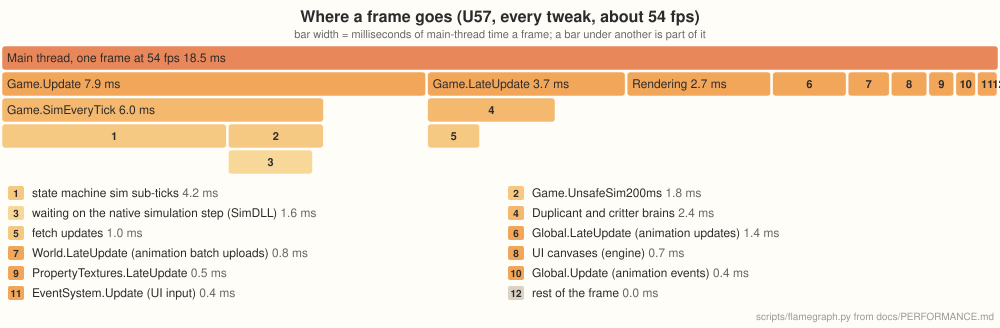

# Performance

How fast oni-brutal runs against the original game, why, and what's still in the way. Three
colonies stress it differently, so each has its own case study:
- **U57**, late game, held back by the game's own logic (this document);
- **2minnow**, mid game, where more of the frame is drawing
  ([PERFORMANCE_CASE_STUDY_2.md](PERFORMANCE_CASE_STUDY_2.md));
- **Gluttony**, very late game with 67 Duplicants, where the simulation's many small updates
  take most of the frame ([PERFORMANCE_CASE_STUDY_3.md](PERFORMANCE_CASE_STUDY_3.md)).

The raw working notes, dead ends included, are in
[research/u57-frame-inventory.md](research/u57-frame-inventory.md).

## How it's measured

On native Windows 11: a Ryzen 7 9800X3D (8 cores, 16 threads), an RTX 3090 with NVIDIA's own
OpenGL driver. Both players load the same save at 1280×720, windowed, with the same probe mod
(`tools/PerfProbe`) holding speed 3 and logging the frame rate every 600 frames. The probe also
turns vsync off and keeps the game from sleeping when its window loses focus (the game slows
itself down then), the same in both players. The original runs as an isolated copy of the
installed game; neither touches the user's own saves or Steam account.

Each configuration ran at least twice, back to back, with nothing else running, and the tables
give the median: runs on a desktop move by up to a quarter when something else wakes up. The
ranges are the 600-frame windows, leaving out the first three (warm-up) and those holding an
autosave. Nothing records the screen during these runs.

Earlier numbers were taken on Linux under WSL2, where OpenGL goes through Mesa's Direct3D 12
backend. That layer makes some driver calls far more expensive than on a native driver (a small
texture upload cost about 75 µs there against about 2.5 µs on Windows), and the game's own code
also ran about half as fast. The case studies' deep dives that still come from Linux say so.

## The numbers

**U57**, a Spaced Out colony with every DLC at cycle 17,077: 24 Duplicants, 1,186 critters, about
62,000 buildings and 90,000 animated objects.

| | Original | oni-brutal | |
|---|---|---|---|
| Frame rate, no tweaks | about 11.4&nbsp;fps (11.3–11.5) | about 48&nbsp;fps (47.8–48.0) | about 4.2× |
| Frame rate, `exact` tweaks (the default) | | about 78&nbsp;fps (76–83) | about 6.9× |
| Frame rate, every tweak | | about 84&nbsp;fps (82–90) | about 7.4× |
| Loading the save | 2&nbsp;min&nbsp;22&nbsp;s | 35–36&nbsp;s | about 4× faster |
| Autosave freeze, no tweaks | 26.1–26.4&nbsp;s | 7.7&nbsp;s | about 3.4× shorter |
| Autosave freeze, `exact` tweaks (the default) | | 2.3&nbsp;s | about 11× shorter |
| Peak memory | 12.5&nbsp;GB | 16.6–16.9&nbsp;GB | about 1.3× |

**2minnow**, a Spaced Out colony with every DLC at cycle 1,990, with 50 Duplicants.

| | Original | oni-brutal | |
|---|---|---|---|
| Frame rate, no tweaks | about 26&nbsp;fps (25.2–26.3) | about 75&nbsp;fps (74.4–75.6) | about 2.9× |
| Frame rate, `exact` tweaks (the default) | | about 91&nbsp;fps (89.7–92) | about 3.5× |
| Frame rate, every tweak | | about 90&nbsp;fps (87.4–92.2) | about 3.5× |
| Loading the save | 49&nbsp;s | 26–27&nbsp;s | about 1.9× faster |
| Autosave freeze, no tweaks | about 5&nbsp;s | 1.6&nbsp;s | about 3× shorter |
| Autosave freeze, `exact` tweaks (the default) | | 0.6&nbsp;s | about 8× shorter |
| Peak memory | 7.0&nbsp;GB | 11.0–11.2&nbsp;GB | about 1.6× |

With no tweaks it's the same game code doing the same work, so those rows are the engine and
runtime alone. The autosave rows time the game's own autosave (what it runs at a cycle's end),
three times in a row, as the longest frame it stalls; the first one in each player is slower
(as code warms up) and is left out. Peak memory is the process's working set, sampled every second
through the load and the autosaves. Ours keeps more: the garbage collector keeps a heap per core
so it can collect in parallel, and the engine keeps caches that make it faster.

## Why the engine alone is faster

Most of it is the runtime. The game's code runs on CoreCLR (.NET 10) instead of Unity's Mono,
with a tiered JIT and profile-guided optimization. Its garbage collector runs in parallel on every
core, its pauses are about a quarter as long, and it's now about 1.4% of a frame.

The rest is the engine itself, profiled on U57 and fixed where the game leans on it hardest
(timed on Linux under WSL2):

| Change | Saved per frame |
|---|---|
| Texture snapshots copied on worker threads (the game re-applies about 20 MB of animation textures every frame) | 2.2 ms |
| Draw queues recorded on worker threads (helpers of the engine's own that sleep between queues), uploads and posting kept in order (`ONI_PARALLEL_DRAWS=0` turns it off) | 1.2 ms (Gluttony 1.8) |
| Component lookups: instances of one prefab share a cached layout, so `GetComponent` goes straight to what it returns instead of testing about 30 components | 1.7 ms |
| The UI walk skips screens hidden by their groups (the game keeps its closed screens active) | 1.3 ms |
| World rotation and scale cached (TextMeshPro reads them for every text, every frame) | 1.1 ms |
| Script dispatch skips removal checks while nothing is being removed | 0.1–0.2 ms |

Pooling draw records and resolving each material's values once per change also cut allocations
by two thirds.

## System by system, before the tweaks

This profile is from before any game tweaks, on Linux under WSL2 (where the game's code ran about
half as fast as on Windows; the proportions are what matter here): an 82 ms frame (12 fps),
sampled with `perf` over 90 s of play. The game's own code was 71% of the main thread (58 ms), the engine 13% (11 ms),
and native code (memory copies, maths, GC) 7%. The last column is what happened to each system
since.

| System | ms | Objects | Why it costs that | Since |
|---|---|---|---|---|
| Rendering (engine) | 6.3 | ~1,500 draws | recording draws, and copying 20 MB a frame of animation textures the game re-applies | copies moved to worker threads, records pooled |
| Animation updates | 3.2 | 89,794 controllers | advancing each playing animation's frame, every frame | real work, scales with what's on screen |
| Cell-change monitor | 2.8 | ~1,400 moved objects a frame | recomputing each moved object's cell, and the handlers for those entering a new cell | real work, mostly conveyor items (`off-screen-conveyors`) |
| Duplicant and critter brains | 2.7 | 1,186 critters, 24 Duplicants | sensors, fetch updates, food and tree searches | real work |
| Animation events | 2.5 | ~6,450 playing animations | reading every playing animation's controller to find its frame events | `fast-anim-events`: 0.9 ms |
| Reachability | 2.5 | ~27,000 workables | every workable re-checked once a game second | `slow-reachability`: 0.53 ms |
| Sublimation | 2.4 | 2,457 items | every item five times a game second, most of them already blocked | `fast-sublimation`: about 1.0 ms |
| UI walk (engine) | 2.4 | ~11,000 UI objects | the game's closed screens stay active, hidden only by their groups | hidden screens skipped: 0.8 ms |
| Plant element absorbers | 1.8 | irrigated plants | the game's event system finding handlers | real work |
| Animation batch uploads | 1.7 | dirty batches | writing per-instance data into batch textures | `fast-symbol-overrides` skips unchanged blocks |
| Workers doing work | 1.6 | 24 Duplicants, 62 remote worker docks | work ticks, splitting element chunks | real work |
| Power | 1.6 | 109 generators | each generator, five times a game second | real work |
| Conveyor rails (sim) | 1.5 | 209 consumers | bridges, consumers, object-layer refreshes | real work |
| Pipes | 1.5 | 821 consumers | consumers, dispensers, bridges | real work |
| Building input checks | 1.4 | 1,918 buildings | power and pipe connections, status items | real work |
| State machine transitions | 1.2 | polled transitions | radiation, fertility and incubation checks | real work |
| Critter temperature | 1.1 | 1,186 critters | each critter's cells checked every tick | real work |
| Conveyor items moving | 1.1 | ~950 items | every item in transit moved along its rail, every frame | `off-screen-conveyors` (changes gameplay) |
| Radbolt collisions | 0.9 | **4 radbolts** | each one gathers all 93,840 colliders around it and asks every one whether it's a radbolt | `fast-particle-collision`: 0.44 ms |
| Ranch stations | 0.9 | stations × critters | type checks on every ranchable critter | real work |
| UI input | 0.7 | | raycasts on mouse events | |
| Moving colliders | 0.7 | | partitioner re-inserts | real work |

"Real work" means the time goes to objects that really do need visiting, and nothing exact was
found to skip.

## Where a frame goes now

Main-thread time on Windows at about 79 fps with every tweak, so about 12.6 ms a frame, averaged
over 600-frame windows. The scripts' own times come from the engine timing each script's update
(`--frame-stats`), and the game methods inside them from a stopwatch around each one (PerfProbe's
`walltime.txt`, which times only methods it can patch without slowing them: about 3% overall). A
bar under another is part of it.

The numbers

Indented rows are part of the row above. `scripts/flamegraph.py` draws the graph from this table.

| Entry point | ms a frame |
|---|---|
| `Game.Update` | 4.4 |
| · `Game.SimEveryTick` | 3.8 |
| · · state machine sim sub-ticks | 2.7 |
| · · `Game.UnsafeSim200ms` | 1.1 |
| · · · waiting on the native simulation step (SimDLL) | 1.0 |
| `Game.LateUpdate` | 2.1 |
| · Duplicant and critter brains | 1.4 |
| · · fetch updates | 0.5 |
| Rendering (engine) | 2.1 |
| `Global.LateUpdate` (animation updates) | 0.9 |
| `World.LateUpdate` (animation batch uploads) | 0.6 |
| UI canvases (engine) | 0.5 |
| `Global.Update` (animation events) | 0.3 |
| `PropertyTextures.LateUpdate` | 0.2 |

The rest of the frame is the smaller scripts and the engine's own frame work. Drawing happens on
a separate GL thread, busy under 1 ms a frame here. The path prober, which runs on its own
thread, costs the main thread about 0.02 ms a frame to hand out its work.

About two thirds of what's left is the game's own logic, spread over dozens of systems. Each one
reads thousands of scattered objects, and none takes more than a couple of milliseconds.

## The tweaks

Players turn them on and off on the main menu's Brutal Tweaks screen; those whose results stay
exactly the same are on by default (`--game-tweak exact`), and `--game-tweak NAME` names them on
the command line. The last column says whether the game's results stay exactly the same; those
that don't are left out of `--game-tweak exact`. The before and
after times were measured on Linux under WSL2, where the game's code ran about half as fast.

| Tweak | Before → after | Results |
|---|---|---|
| `fast-jobs`: worker threads aren't all woken and waited on for every small job (about 14 a frame) | about +11% frame rate | exact |
| `fast-anim-events`: the animation event loop reads a compact copy of each controller | 2.07 → 0.90 ms | exact |
| `fast-sublimation`: items already blocked by full gas cells are skipped in one batched update | 1.45 → about 1.0 ms | exact |
| `fast-particle-collision`: a radbolt skips the collider gather when no other radbolt is nearby | 0.94 → 0.44 ms | exact |
| `fast-offset-tables`: fetch updates recheck only items whose work spots can have changed | 1.74 → 1.33 ms | exact |
| `fast-anim-cleanup`: the sweep for destroyed animations skips chunks that can't hold any | 0.48 → 0.12 ms | exact |
| `fast-partitioner-cleanup`: the spatial index's cleanup looks only at entries that were removed | Gluttony: 0.38 → 0.16 ms | exact |
| `fast-symbol-overrides`: unchanged symbol-override blocks aren't uploaded again | 1.47 → 1.20 ms | exact |
| `fast-anim-batches`: animation batches write their controllers' instance and symbol data on worker threads, the rest in the game's order | Gluttony: 1.9–2.0 → 1.5–1.65 ms | exact |
| `fast-overlays`: the temperature overlay passes over the buildings out of view without reading them, the power overlay asks each circuit's load once a frame, and the other overlays keep what their targets' visits read (see [research/overlays.md](research/overlays.md)) | temperature 10.4 → 6.0 ms (2minnow 6.5 → 3.8–4.0), power 1.28 → 0.77–0.95, materials 4.05 → 3.8, decor 4.32 → 3.6–4.0 | exact |
| `fast-conveyor-paths`: the conveyor rails' network rebuild (on every rail built, removed or reconnected, and at the load) answers its path searches from an index of the paths it keeps instead of searching every kept path for every path found | U57: a rebuild 50–510 → 2–14 ms, the load's 840–850 → 14 ms | exact |
| Save tweaks: `fast-serialization`, `fast-save-type-checks`, `fast-save-compression`, `no-save-gc`, `background-save` | autosave freeze 11.7 → 4.8 s | exact, and saves still load in the original |
| `slow-reachability`: reachability re-checked every 4 game seconds instead of every second | 1.88 → 0.53 ms | changes timing |
| `off-screen-conveyors`: items on rails off screen are placed when they stop or come into view | skips most of about 950 moves a frame | changes positions while off screen |
| `off-world-fallers`: items that fell out of the bottom of a world are landed where they hang | A possible perf. fix in degenerate cases where debris kept at the bottom of melted rocket interiors are treated as always falling. See [case study 3](PERFORMANCE_CASE_STUDY_3.md#objects-falling-forever) | they stop counting as falling |

The exact tweaks that skip work each have a verify mode, which recomputes whatever was skipped
and counts disagreements. `scripts/qa.sh` runs them all on U57 for at least 10 game minutes,
opening every overlay in turn, and requires zero. `fast-symbol-overrides` doesn't need one: it only skips writing values that are
already there.

## Tried and dropped

Measured ideas that didn't pay off, so nobody needs to try them again:
- Caching the whole UI build: it never hit, because the HUD changes every frame.
- Skipping uploads of identical animation frames: not exact (some objects change their data
  without marking it dirty), and no faster anyway.
- Recording immediate draws and command buffers on worker threads: the game changes materials
  between those draws, so each draw's inputs would need copying, which costs about as much as
  it saves. Queued draws have no game code between them and are now recorded on workers (see
  [research/parallel-main-thread.md](research/parallel-main-thread.md)).
- Recording draw queues with `Parallel.For`: on a busy machine the thread pool's workers spin
  for work after each one, taking the cores of the GL thread and the game's job threads (U57
  with 12 of 16 cores busy: 14.3 fps against 17.5 serial). Helper threads that sleep give
  19.2.
- Building navigation links on worker threads: exact, but each update is too small (about
  40 µs) for a fork and join to pay.
- Early-outs inside per-item systems like sublimation and sensors: the cost is reaching each
  object at all, not the work after that.
- Equivalents of Fast Track (Peter Han's mod), reviewed option by option: the ones that would
  matter here all change what the game does.

## What's left

The biggest per-object costs are animation updates, cell-change
handlers, brains, conduits, power and critter temperature, at 1–3 ms each. It's spread thin, and
the time goes to cache misses chasing object references, not to computation.

A spike compared flat arrays against reading the game's objects. Sublimation's
decision dropped from about 400 ns to about 5 ns per item, and a pickupable scan from about
160 ns to about 1 ns. Rewriting the per-item systems that way could save up to about 10 ms of a
70 ms frame (on Linux, before the tweaks). But mods and the UI write the same game state, so it would mean rewriting the game's
systems rather than tweaking them.

## Loading

Loading U57 takes 35–36 s on Windows, against 2 min 22 s in the original. Profiled on Linux,
about two thirds of it is the game's own work (reading the save and setting up each object), and about a quarter is the engine
creating those objects. Unloading unused assets during the load takes another 1.2 s. The JIT
isn't the bottleneck: compiling ahead of time (ReadyToRun) saved nothing measurable.

## Start-up

From process start to the main menu on Linux under WSL2 (Mesa's d3d12 driver), 1280×720, three
rounds back to back on a quiet machine, each round the original and each build of ours, with the
page cache warm; the medians:

| | Original | First round of changes | Now | Now, without background uploads |
|---|---|---|---|---|
| Menu on screen, every DLC | 25&nbsp;s | 21&nbsp;s | 12&nbsp;s | 20.5&nbsp;s |
| Menu on screen, base game | 11&nbsp;s | 12&nbsp;s | 6.5&nbsp;s | 12&nbsp;s |
| Klei's logo on screen | 4.5–5&nbsp;s | 7&nbsp;s | 2.5&nbsp;s | 6.5–7&nbsp;s |

(Before any of the changes the menu took 40.5 s with every DLC and 19 s for the base game, on a
busier machine.) Where the time goes now, in ms since the process started (base game, then every
DLC):

| | First round | Now |
|---|---|---|
| Window and GL device ready | 1,068 / 1,236 | 792 / 964 |
| First scene loaded | 2,188 / 2,458 | 1,914 / 2,157 |
| Frame 0 done (Klei's logo) | 6,371 / 6,595 | 2,052 / 2,295 |
| Frame 1 done (the game's start-up) | 9,465 / 18,190 | 5,492 / 10,030 |
| The menu's first frame done | 11,566 / 19,416 | 6,212 / 10,775 |

- The first scene's Global prefab references every animation texture: about 2,550 textures,
  2 GiB, which Unity uploads before its first frame. They now go to the GPU in the background
  (ARCHITECTURE §3.5): the GL thread uploads them between frames, about 400 MB/s through Mesa's
  d3d12 driver, done 3.5–3.9 s after start, while frame 1 runs the game's start-up. With every
  DLC, the content bundles' 880 MiB of textures go up as the bundles load and are done before
  the start-up frame ends (they used to be recorded at its end, and the menu's first frame
  waited for them). Frame 0 went from 6.1–6.3 s to 2.0–2.3 s, the menu's first frame from
  1.2–2.2 s to 0.7–0.8 s. The longest single upload is 10–150 ms. Through two colonies resumed from
  the menu (DeCrew, base game; U57, every DLC; 3,000 frames each), the same two frames over
  100 ms as before once they have loaded (115–307 ms against 126–361 ms).
- The DLC bundles (one LZMA stream each, about 1 GiB decompressed) are decompressed on worker
  threads from the player's start (`ONI_BUNDLE_PREFETCH=0` turns it off); loading them takes
  the game 0.3–0.6 s instead of 9–11 s.
- The host's patches of the game and of Harmony are made while the window opens: the window and
  device are ready 0.28 s sooner.
- Serialized files are mapped instead of read whole: the first scene loads about 50 ms sooner,
  and no 391 MB array is allocated for sharedassets0.assets. Parsing its metadata (type trees,
  the object table) takes about 10 ms, so a cache of the parsed file across launches has nothing
  left to save; what loading the scene costs (about 1 s) is the scene's MonoBehaviours' fields
  (about 0.6 s) and the game's own Awake (about 0.5 s).
- What remains is the game's own start-up (Steam, FMOD loading its banks, the Global prefab
  with `Assets`, `Db`, the mods and the localization): 3.4 s for the base game, 7.7 s with every
  DLC, and the original's is no shorter.

The original shows a black window for 4.5–5 s, then Klei's logo, still, until its menu.
`--splash moo` (ARCHITECTURE §3.5) changes nothing in these times.

`ONI_STARTUP_STATS=1` logs the start-up phases with the time since the process started, and for
each slow frame its texel reads, uploads, program builds, GL-thread time and window-message pumps.
