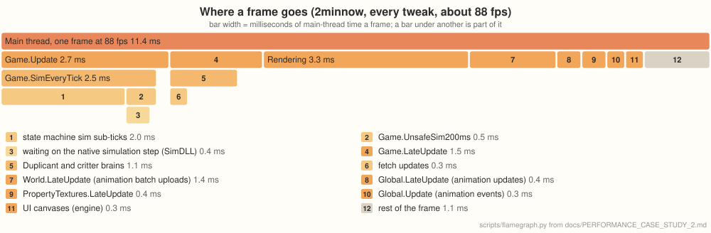

# Performance case study 2: a mid-game colony

[PERFORMANCE.md](PERFORMANCE.md) follows U57, a late-game colony where the game's own logic
takes most of the frame. This one follows 2minnow, a younger colony whose frame is lighter on
logic, so drawing takes a larger share, and the engine's own work shows more.

## The colony

2minnow is a Spaced Out colony with every DLC, the Aquatic one included, at cycle 1,990 with 50
Duplicants. It's measured exactly as U57 is (see [How it's measured](PERFORMANCE.md#how-its-measured)):
native Windows, 1280×720, speed 3, the median of back-to-back runs with nothing else running.

## The numbers

| | Original | oni-brutal | |
|---|---|---|---|
| Frame rate, no tweaks | about 26&nbsp;fps (25.2–26.3) | about 75&nbsp;fps (74.4–75.6) | about 2.9× |
| Frame rate, `exact` tweaks (the default) | | about 91&nbsp;fps (89.7–92) | about 3.5× |
| Frame rate, every tweak | | about 90&nbsp;fps (87.4–92.2) | about 3.5× |
| Loading the save | 49&nbsp;s | 26–27&nbsp;s | about 1.9× faster |
| Autosave freeze, no tweaks | about 5&nbsp;s | 1.6&nbsp;s | about 3× shorter |
| Autosave freeze, `exact` tweaks (the default) | | 0.6&nbsp;s | about 8× shorter |
| Peak memory | 7.0&nbsp;GB | 11.0–11.2&nbsp;GB | about 1.6× |

## How it differs from U57

- **The engine and runtime alone gain less:** 2.9× here against 4.2× on U57. The original
  most likely struggles more with U57's far larger number of objects, which is where CoreCLR's
  faster code and collector pay off most.
- **The tweaks add less, and the two that change gameplay add nothing:** they target the costs
  of a large late-game colony (reachability over 27,000 workables, conveyor items, animation
  events), and this colony has far fewer of those.
- **Drawing is a bigger share.** The main thread spends about 3.3 ms a frame recording draws, against
  2.1 ms on U57, and the GL thread is busy about 3 ms a frame, most of it re-uploading the
  animation batches' data textures the game rewrites every frame.

## Where a frame goes

Main-thread time on Windows at about 88 fps with every tweak, so about 11.3 ms a frame, measured
as for U57. A bar under another is part of it.

The numbers

Indented rows are part of the row above. `scripts/flamegraph.py` draws the graph from this table.

| Entry point | ms a frame |
|---|---|
| `Game.Update` | 2.7 |
| · `Game.SimEveryTick` | 2.5 |
| · · state machine sim sub-ticks | 2.0 |
| · · `Game.UnsafeSim200ms` | 0.5 |
| · · · waiting on the native simulation step (SimDLL) | 0.4 |
| `Game.LateUpdate` | 1.5 |
| · Duplicant and critter brains | 1.1 |
| · · fetch updates | 0.3 |
| Rendering (engine) | 3.3 |
| `World.LateUpdate` (animation batch uploads) | 1.4 |
| `Global.LateUpdate` (animation updates) | 0.4 |
| `PropertyTextures.LateUpdate` | 0.4 |
| `Global.Update` (animation events) | 0.3 |
| UI canvases (engine) | 0.3 |

## What changed for it

**Only the changed rows of a re-uploaded texture are sent.** The game re-applies its animation
batches' data textures every frame (256×256, 1 MB each), but half of them haven't changed at all,
and the others change about 2% of their rows. The engine now keeps a copy of what it last uploaded
for each such texture and sends only the rows between the first and last that differ, or
nothing. On Windows that halved the GL thread's upload time on this colony (6.1 to 3.0 ms a
frame) and cut the data sent from about 28 MB a frame to about 1.5 MB. The texture's contents end
up exactly as a full upload would leave them: `ONI_VERIFY_PARTIAL_UPLOADS` reads each one back to
check, and QA's verify stage runs it (278,000 checked, none different).

## A note on measuring under WSL

This colony was first profiled on Linux under WSL2, and that picture was misleading. There,
OpenGL goes through Mesa's Direct3D 12 backend, which charged about 75 µs for each of the roughly
230 tiny (16×16) texture uploads a frame, against about 2.5 µs on Windows' native driver: the GL
thread was busy 22 ms a frame and looked like the bottleneck. On Windows the same thread is busy
about 3 ms. Main-thread logic measured under WSL keeps its proportions, but GL-thread and GPU
costs need a native driver.

## What's left

At about 11 ms a frame, no single system dominates. Drawing (3.3 ms on the main thread) is the
largest share, then the simulation's state machine updates (2 ms) and the brains (1.1 ms). The
animation batch uploads (1.4 ms on the main thread) still copy every batch's texels before the GL
thread compares them; comparing on the main thread first could skip the copy for unchanged ones.
