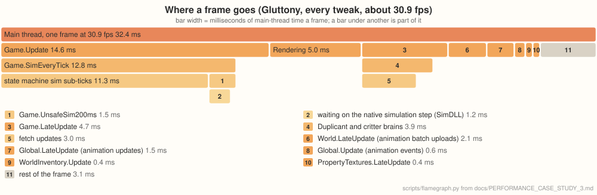

# Performance case study 3: a very late colony

[PERFORMANCE.md](PERFORMANCE.md) follows U57 and [PERFORMANCE_CASE_STUDY_2.md](PERFORMANCE_CASE_STUDY_2.md)
follows 2minnow. This one follows Gluttony, a colony nearly as old as U57 with almost three
times as many Duplicants and a far busier simulation, and one odd thing in its save that cost
more than anything else in its frame.

## The colony

Gluttony is a Spaced Out colony at cycle 15,304 with 67 Duplicants, on a 1160×194 cluster. Its
save is 187 MB, and both players use about 17–19 GB of memory to run it.

It's measured as U57 is (see [How it's measured](PERFORMANCE.md#how-its-measured)), with one
difference: both players ran at high process priority with Windows' power throttling turned off
for them. Without that, runs made while the machine was in use fell into a slow mode, stuck at
20–23 fps instead of 30, whenever the game's window wasn't focused. The original was run the
same way.

## Objects falling forever

The save holds 17,552 objects that are always falling and never move: 10,317 diamonds and about
7,200 egg shells, half a cell below the bottom of two rocket interiors, where a conveyor chute
drops them out through the floor. The game steps every falling object thirty times a game
second (`GravityComponents.FixedUpdate`). An object's next position here would be outside its
world, so the step leaves it where it is, still falling, and it is stepped again the next tick,
forever. That cost about 8.5 ms a frame, the largest single item in the frame, and the original
pays it too.

Two ways around it were measured:
- **A cleaned copy of the save**, with those objects destroyed (written by Moono; it loads
  in the original too). This is the colony as it would be without the chute, and the numbers
  below use it unless they say otherwise.
- **The `off-world-fallers` tweak** (opt-in, **changes gameplay**): an item that falls straight
  down out of its world and can never move again is landed where it hangs, through the game's
  own landing for items. It stops counting as falling and stays put; if its rocket interior is
  destroyed and its items are moved to the world below, it falls from there at rest. On the
  original save it takes the gravity step from about 17,570 objects to 33 (railgun payloads in
  flight), and the frame rate from about 18.6 to 25.1 fps.

The tweak doesn't reach the cleaned save's 30 fps because the items still exist: 10,000 objects
stacked on one cell make every change to that cell's item list, partitioner node and
reachability checks slower. Only removing them recovers that.

## The numbers

On the cleaned save:

| | Original | Moono | |
|---|---|---|---|
| Frame rate, no tweaks | about 9.7&nbsp;fps (8.9–10.0) | about 26&nbsp;fps (21.4–27.6) | about 2.7× |
| Frame rate, `exact` tweaks (the default) | | about 30&nbsp;fps (27.0–32.6) | about 3.1× |
| Frame rate, every tweak | | about 30&nbsp;fps (23.1–34.2) | about 3.1× |
| Loading the save | 4&nbsp;min&nbsp;3&nbsp;s | 41&nbsp;s | about 6× faster |
| Autosave freeze, `exact` tweaks | about 32&nbsp;s | about 3&nbsp;s | about 10× shorter |
| Peak memory | 16.6&nbsp;GB | 18.5&nbsp;GB | about 1.1× |

On the original save, with the stuck objects:

| | Original | Moono | |
|---|---|---|---|
| Frame rate, `exact` tweaks | about 6.1&nbsp;fps (5.9–6.2) | about 18.6&nbsp;fps (16.5–19.3) | about 3× |
| Frame rate, every tweak (with `off-world-fallers`) | | about 25&nbsp;fps (24.4–26.0) | about 4.1× |

## How it differs from U57

- **The gain is smaller:** about 3× against U57's 7×. U57's frame had a few large costs the
  tweaks remove (reachability, sublimation, animation events, conveyor items). Gluttony's is
  spread thin: its sim sub-ticks run 386 separate update systems for 70 Duplicants, 1,021
  critters, 74,000 buildings and 558,000 workables, the largest 1.3 ms on Linux and only 13 over
  0.2 ms. That is plain game logic CoreCLR runs faster, with no single cost for a tweak to
  remove. [research/gluttony-frame-inventory.md](research/gluttony-frame-inventory.md) has the
  full inventory.
- **Loading and saving gain the most.** The save is about twice U57's size, and the original
  takes four minutes to load it and freezes for half a minute on each autosave.
- **The memory gap is narrow:** about 1.1× here against 1.6× on 2minnow.

## Where a frame goes

Main-thread time on Windows at about 31 fps with every tweak, so about 32 ms a frame, measured
as for U57. A bar under another is part of it.

The numbers

Indented rows are part of the row above. `scripts/flamegraph.py` draws the graph from this table.

| Entry point | ms a frame |
|---|---|
| `Game.Update` | 14.6 |
| · `Game.SimEveryTick` | 12.8 |
| · · state machine sim sub-ticks | 11.3 |
| · · `Game.UnsafeSim200ms` | 1.5 |
| · · · waiting on the native simulation step (SimDLL) | 1.2 |
| Rendering (engine) | 5.0 |
| `Game.LateUpdate` | 4.7 |
| · Duplicant and critter brains | 3.9 |
| · · fetch updates | 3.0 |
| `World.LateUpdate` (animation batch uploads) | 2.1 |
| `Global.LateUpdate` (animation updates) | 1.5 |
| `Global.Update` (animation events) | 0.6 |
| `WorldInventory.Update` | 0.4 |
| `PropertyTextures.LateUpdate` | 0.4 |

The GPU is busy about 9 ms a frame, well under the frame time.

## What's in the sub-ticks

The state machine sub-ticks are the frame's bulk, and they are spread thin. A profile on Linux
(where the game's code runs slower but keeps its proportions) splits them roughly as:
- radbolt collision checks (`HighEnergyParticle.CheckCollision`), about a fifth before the
  change below, about a tenth after it;
- buildings' input checks (`RequireInputs`), sublimation and amounts (stress, calories,
  breath), each a few percent;
- the rest: hundreds of small state machine updaters for critters, ranches, machines and
  Duplicants, none more than a few percent.

## What was tried

- **A faster gravity step** (skipping the cleanup set's hashing when it is empty) gave no
  measurable gain; the stuck objects' cost was reading their scattered transforms, not the
  bookkeeping.

## What changed for it

**Each radbolt's colliders are looked up once.** `fast-particle-collision` skips a radbolt's
collider gather unless another radbolt is registered nearby, and to tell, it checked every other
live radbolt's colliders, looking them up on the radbolt's GameObject each time. With many
radbolts in flight that was every radbolt against every other, each frame. A radbolt's colliders
are its prefab's, so they are now looked up the first time and kept. On Linux the radbolt checks
went from about 2.9 to 1.5 ms a frame, and the frame rate from about 22.5 to 24.4 fps. The
Windows numbers above were measured before this change.

## What's left

At about 32 ms a frame, the simulation's own logic is two thirds of the main thread, spread over
many small updaters, none of them large enough on its own to be worth a tweak yet.
